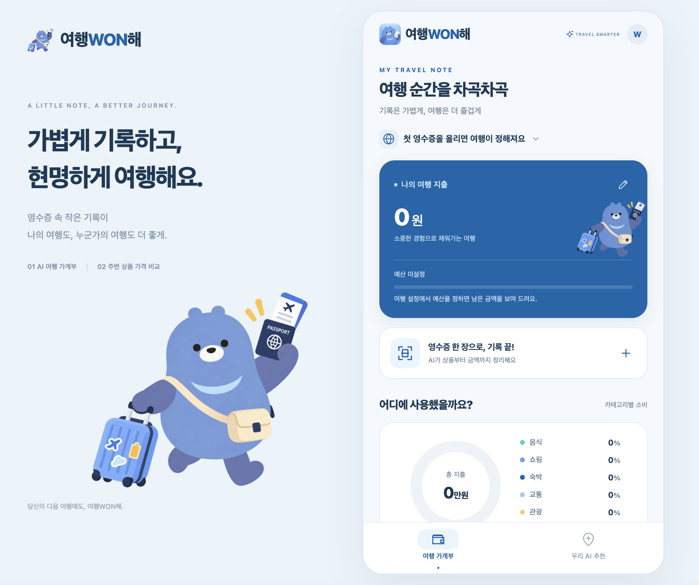
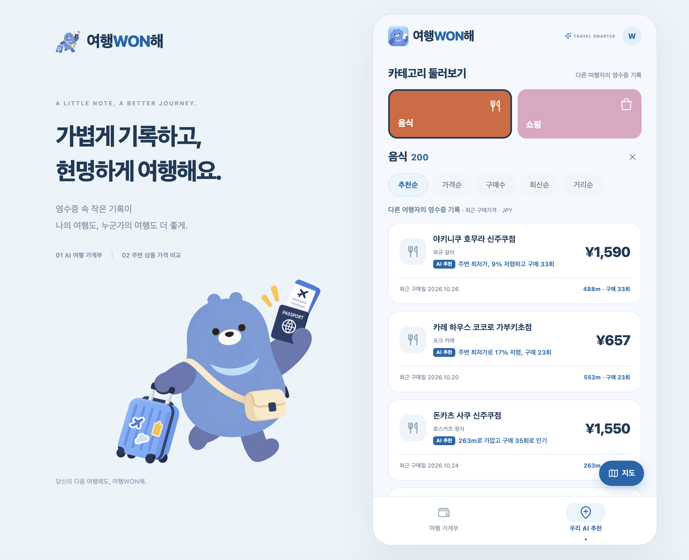

# 여행WON해 — 영수증 기반 여행 가계부·가격 탐색 앱

영수증 한 장으로 여행 가계부를 쓰고, 다른 여행자의 영수증 기록으로 상품 가격과 매장을 살펴보는 모바일 여행 앱입니다. 영수증 사진을 AI가 읽어 매장·구매일·상품별 가격을 정리합니다. 저장한 실제 영수증은 다른 여행자의 가격 비교 데이터가 됩니다.

앱은 Expo·React Native(iOS·Android·웹), 서버는 Java 21·Spring Boot·Spring AI로 만들었습니다. 기존 서비스의 이름 **여행WON해**, 테마 색 `#0067AC`, 여행푸딩 캐릭터를 이어 씁니다. `my-hackathon`과는 독립적으로 실행하는 프로젝트이며, 기존 프로젝트의 데이터는 옮겨 오지 않습니다.

## 서비스 화면

| 여행 가계부 | 우리 AI 추천 |
| --- | --- |
|  |  |

## 서비스 구성

| 탭  | 이름         | 목적                                                                 |
| --- | ------------ | -------------------------------------------------------------------- |
| 1   | 여행 가계부  | 영수증 OCR로 지출을 기록하고, 카테고리·예산·다른 여행자 평균으로 소비를 분석 |
| 2   | 우리 AI 추천 | 다른 여행자의 영수증 기록으로 주변 상품 가격과 매장을 비교·추천          |

### 1. 여행 가계부

- **영수증 등록**: 촬영하거나 사진을 고르면 AI가 매장·구매일·통화·상품별 가격을 추출합니다. 확인·수정한 뒤 저장하고, 직접 입력도 할 수 있습니다.
- **환율과 예산**: 한국수출입은행 환율로 원화를 환산하고, 첫 영수증으로 여행 지역·기간을 자동으로 채웁니다.
- **소비 분석**: 카테고리별 차트, 같은 나라 다른 여행자의 평균과 비교, AI 소비 인사이트를 보여 줍니다.
- **엑셀 내보내기**: 영수증 품목을 엑셀 파일(.xlsx)로 내보냅니다.

### 2. 우리 AI 추천

- **검색과 카테고리 둘러보기**: 상품명·매장명(원문·한국어)으로 찾거나 카테고리를 골라 매장별 최근 구매가격을 봅니다.
- **AI 추천순**: 가격·거리·구매 수와 내 예산을 반영해 점수를 매기고, 상위 3개에 AI 추천 이유를 붙입니다. 가격순·구매수·최신순·거리순 정렬도 됩니다.
- **지도**: 목록의 매장을 반경 3km 지도에 가격 마커로 보여 줍니다. 기본 위치는 도쿄 신주쿠역이고, "내 위치"로 바꿀 수 있습니다.

> 영수증 가격은 과거 구매가격이므로 현재 판매가격과 재고는 다를 수 있습니다.

## AI 처리 흐름

| 단계 | 담당           | 내용                                                                                                                   |
| ---- | -------------- | ---------------------------------------------------------------------------------------------------------------------- |
| 입력 | 사용자         | 영수증 사진(촬영·사진 선택) 또는 직접 입력                                                                             |
| 해석 | AI             | 서버가 사진을 Spring AI `ChatClient`로 Claude에 보내 매장·구매일·통화·카테고리·상품별 수량·단가를 JSON으로 추출. 금액은 소수 문자열로 받아 서버가 최소 단위로 변환 |
| 확인 | 사용자         | 인식 결과를 확인·수정                                                                                                  |
| 계산 | 일반 계산 엔진 | 상품 합계와 총액 일치 검증, 원화 환산, 카테고리 비율·예산, 상품명 정규화, 매장별 최신 가격·구매수 집계                 |
| 결과 | 서비스         | 가계부 시각화, 상품 가격 비교, 카테고리 둘러보기                                                                       |

AI는 영수증 해석, 추천 이유, 소비 인사이트 문장만 맡고, 금액 계산과 검증은 프로그램이 수행합니다. 키가 없거나 AI 호출에 실패하면 직접 입력이나 규칙 기반 결과로 이어 갑니다. 자세한 내용은 [docs/AI_utils/](docs/AI_utils/README.md)에 있습니다.

## 데이터와 한계

- **저장**: 가계부는 기기(웹은 브라우저 localStorage)에 먼저 저장하고 서버와 동기화합니다. 서버에 연결되지 않으면 기기에만 저장합니다.
- **서버 DB**: 기본은 빈 H2 파일 DB이고, `npm run server:mysql`로 실행하면 신주쿠 가데이터가 든 MySQL(`travel_won`)을 씁니다([docs/db-design.md](docs/db-design.md)).
- **가격 공유**: 매장 위치가 있는 실제 영수증은 별도 동의 절차 없이 공유됩니다(팀 결정). 영수증 사진과 결제정보는 공유하지 않습니다.
- **시연 범위**: 실제 GPS 대신 신주쿠역 근처 가상 좌표를 쓰고, 환율은 참고값입니다.
- **운영 전 필요한 것**: 로컬 해커톤용 단일 서버입니다. 공개 운영에는 사용자 인증, HTTPS, 운영 DB, 접근 제어가 필요합니다.

## 로컬에서 실행하기 (How to Run)

**API 서버**와 **화면(앱)**을 터미널 두 개에서 따로 실행합니다. 화면은 웹 브라우저나 휴대폰(Expo Go) 중 하나로 엽니다.

|                             | 웹 브라우저                    | 모바일 (Expo Go)                      |
| --------------------------- | ------------------------------ | ------------------------------------- |
| 화면 실행 명령              | `npm run web`                  | `npm start` → QR 코드 스캔            |
| 화면 주소                   | http://localhost:8081          | Expo Go 앱                            |
| `.env`의 `EXPO_PUBLIC_API_URL` | 비워 두기(기본값 `http://localhost:8787`) | `http://<노트북 LAN IP>:8787`        |

### 1. 준비 (처음 한 번)

Node.js **22.13 이상**과 **JDK 21**이 필요합니다. Gradle은 포함된 `./gradlew`를 씁니다. 아래 명령은 모두 프로젝트 루트(`travel_WONIT/`)에서 실행합니다.

```bash
npm ci
cp .env.example .env      # Windows: copy .env.example .env
```

`.env`에 넣는 값은 팀 안에서 따로 전달받습니다. `EXPO_PUBLIC_`으로 시작하는 값은 앱 번들에 포함되므로 비밀 키를 넣지 않습니다.

| 변수                           | 용도                                         | 필요한 경우            |
| ------------------------------ | -------------------------------------------- | ---------------------- |
| `ANTHROPIC_API_KEY`            | 영수증 사진 분석·AI 추천·소비 인사이트(Claude) | AI 기능                |
| `KOREAEXIM_API_KEY`            | 한국수출입은행 환율                           | 오늘 환율 채우기       |
| `DB_URL`, `DB_USERNAME`, `DB_PASSWORD` | MySQL(`travel_won`) 접속 정보          | `npm run server:mysql` |
| `EXPO_PUBLIC_API_URL`          | 앱이 호출할 API 서버 주소 (아래 2단계 참고)   | 모바일                 |
| `EXPO_PUBLIC_MAPBOX_TOKEN`     | Mapbox 지도 공개 토큰(`pk.`). 없으면 OpenStreetMap | 선택              |
| `ALLOWED_ORIGINS`              | API를 호출할 수 있는 웹 주소(기본 `localhost:8081`) | 웹을 다른 포트로 열 때 |

### 2. API 서버 실행 (터미널 1)

```bash
npm run server:mysql      # MySQL(travel_won). 우리 AI 추천 탭의 가데이터가 보입니다
npm run server            # H2(빈 DB). DB 접속 정보 없이 가계부만 확인할 때
```

Windows에서는 `.\gradlew.bat bootRun --args="--spring.profiles.active=mysql"`(MySQL) 또는 `.\gradlew.bat bootRun`(H2)을 실행합니다.

터미널에 `Started TravelWonhaeApplication`이 나오면 준비된 것입니다. 이 서버에는 화면이 없고, http://localhost:8787/health 에서 `"ok":true`로 상태를 확인합니다.

> `npm run server`는 `.env`에 DB 값이 있어도 항상 빈 H2를 씁니다. 우리 AI 추천 탭이 비어 있으면 `server:mysql`로 실행했는지 확인합니다.

### 3-A. 웹 브라우저로 실행 (터미널 2)

1. `.env`의 `EXPO_PUBLIC_API_URL` 줄을 주석 처리하거나 `http://localhost:8787`로 둡니다.
2. 웹 화면을 실행하고 브라우저에서 http://localhost:8081 을 엽니다.

   ```bash
   npm run web
   ```

8081이 아닌 포트로 열리면 API 호출이 막힙니다(CORS). 8081을 쓰는 프로그램을 끄거나, 새 주소를 `ALLOWED_ORIGINS`에 추가하고 서버를 다시 시작합니다.

### 3-B. 모바일(iPhone·Android)로 실행 (터미널 2)

1. 휴대폰에 **Expo Go**(Expo SDK 58 지원)를 설치하고, 노트북과 **같은 Wi-Fi**에 연결합니다.
2. 노트북의 LAN IP를 확인합니다.

   ```bash
   ipconfig getifaddr en0    # macOS (Windows: ipconfig의 IPv4 주소)
   ```

3. `.env`의 `EXPO_PUBLIC_API_URL`을 그 IP로 바꿉니다. 휴대폰에서 `localhost`는 휴대폰 자신을 가리키므로 쓸 수 없습니다.

   ```bash
   EXPO_PUBLIC_API_URL=http://192.168.0.10:8787   # 예시. 확인한 IP로 바꿉니다
   ```

4. 앱을 실행하고, 휴대폰 카메라(iPhone)나 Expo Go(Android)로 터미널의 QR 코드를 스캔합니다.

   ```bash
   npm start
   ```

- **Wi-Fi가 바뀌면 IP도 바뀝니다.** "가격 기록을 불러오지 못했어요" 같은 연결 오류가 나면 2~3단계를 다시 합니다. 이 주소는 웹 화면에도 적용되므로, 웹만 쓸 때는 3-A처럼 비워 두는 편이 안전합니다.
- macOS 방화벽에서 Java가 들어오는 연결을 받을 수 있게 허용합니다.
- 영수증은 앱 안의 **촬영하기**를 권장합니다. 서버의 사진 한도는 10MB입니다.
- Android 에뮬레이터는 `EXPO_PUBLIC_API_URL` 없이 `http://10.0.2.2:8787`을 씁니다.

> `EXPO_PUBLIC_` 값을 바꾸면 화면(`npm run web`·`npm start`)을, 나머지 값을 바꾸면 API 서버를 다시 시작합니다. 바꾼 값이 반영되지 않으면 `npx expo start -c`로 캐시를 지우고 실행합니다.

### 4. 테스트와 검증

```bash
npm test               # 계산·정규화·카테고리 단위 테스트
npm run typecheck      # TypeScript 검사
./gradlew test         # 서버 API·DB·OCR·환율 테스트 (H2라 MySQL 없이 실행)
npm run test:browser   # 웹 번들·서버를 빌드해 Chrome으로 사용자 흐름 확인 (8787 포트를 비우고 실행)
```

종료할 때는 각 터미널에서 `Ctrl + C`를 누릅니다.

## API

| 메서드 | 경로      | 설명                                                                                   |
| ------ | --------- | -------------------------------------------------------------------------------------- |
| GET    | `/health` | 서버 상태와 OCR 키 설정 여부                                                           |
| POST   | `/api/receipts/ocr` | 영수증 사진 분석. multipart `file`(JPG·PNG·WEBP, 10MB 이하). IP당 시간당 20회. 오류는 `{errors:[{field, code, message}]}` |
| GET    | `/api/exchange-rates/{currency}` | 1 외화당 원화 참고 환율 `{currency, rate, date, source}`(한국수출입은행 매매기준율). 불러오지 못하면 503 `RATE_UNAVAILABLE` |
| GET    | `/ledger` | 이 기기의 가계부 `{state: {version, trip, receipts}}`. 저장한 적이 없으면 `state: null` |
| PUT    | `/ledger` | 이 기기의 가계부를 통째로 교체. 시연 영수증(`demo: true`)은 저장하지 않고, 매장 위치가 있는 영수증만 공유. 하나라도 잘못되면 아무것도 바꾸지 않음 |
| GET    | `/prices` | 우리 AI 추천 탭 조회. `currency`·`latitude`·`longitude` 필수, `category`·`q`(상품명)·`sort`(추천순·가격순·구매수·최신순·거리순)·`radius`(기본 3000m) 선택. 매장·상품별 최근 가격과 구매수 |
| POST   | `/insight` | 가계부 소비 인사이트 |

`/ledger`는 `Authorization: Bearer <기기 토큰>` 헤더가 필요합니다. 기기 토큰은 앱이 처음 실행할 때 만듭니다.

## 프로젝트 구조

[WONIT-A/05_springAI](https://github.com/WONIT-A/05_springAI)의 기술 구성(Java 21·Spring Boot·Spring AI·Spring Data JPA·Gradle)과 계층별 책임을 참고했습니다. 프런트엔드는 모바일 앱 요구에 맞춰 React·Vite 대신 Expo·React Native를 씁니다.

```text
travel_WONIT/
├── App.tsx                       하단 탭·공유 상태·기기 저장·서버 동기화
├── index.ts                      앱 진입점
├── app.config.ts                 앱 이름·아이콘·카메라·사진·위치 권한
├── assets/                       앱에서 쓰는 이미지 (여행푸딩·영수증푸딩)
├── img/                          원본 이미지와 화면 참고 자료
├── src/
│   ├── screens/
│   │   ├── Ledger.tsx            여행 가계부
│   │   └── Compare.tsx           주변 가격 비교·카테고리 둘러보기
│   ├── components/
│   │   ├── ReceiptEditor.tsx     촬영·OCR·항목 수정·공유 설정
│   │   ├── TripSettings.tsx      여행·예산·시연 기록 관리
│   │   ├── PriceMap.tsx          지도 타일과 가격 마커
│   │   └── ui.tsx                공통 UI·아이콘
│   ├── domain.mjs                금액 계산·상품 정규화·가격 비교·카테고리 집계·시연 데이터
│   ├── api.ts                    서버 요청
│   ├── types.ts                  공용 타입
│   ├── main/java/com/wonit/travel/
│   │   ├── api/                  REST 컨트롤러·CORS·오류 처리·요청 크기 제한
│   │   ├── ocr/                  Claude 영수증 리더(Spring AI ChatClient)·초안 변환
│   │   ├── ledger/               가계부: 기기·여행·영수증·품목 JPA 엔티티·저장소·서비스
│   │   ├── price/                PAGE 2 조회: 반경·카테고리·검색·정렬
│   │   └── rate/                 한국수출입은행 환율 조회·고시일 캐시
│   ├── main/resources/           Spring 설정 (기본 H2, mysql 프로필)
│   └── test/java/                JUnit 5 API·DB·OCR·환율·MySQL 프로필 테스트
├── tests/domain.test.mjs         계산·정규화·공유 동의·카테고리 테스트
├── scripts/browser-check.mjs     Chrome 사용자 흐름 검증
├── scripts/sample-data.mjs       시연용 가데이터 CSV 생성 (npm run sample-data)
├── sample-data/                  도쿄 신주쿠 가데이터 CSV (travel_won에 적재함)
├── build.gradle                  Java 21·Spring Boot·Spring AI·JPA·H2
└── docs/                         명세 원본·검토 결과·검증 기록·화면 캡처
```

`App.tsx`가 탭 전환과 공유 상태를 연결합니다. 계산은 `src/domain.mjs`, 서버 호출은 `src/api.ts`가 맡습니다. 서버는 컨트롤러 → 서비스 → JPA 저장소 순서로 책임을 나눕니다.

## 관련 문서

- [db-backups/README.md](db-backups/README.md): 4개 테이블·가데이터 시점별 보관, 프로젝트 밖 사본, 안전 실행·복구 절차 (`npm run db:snapshot`, `npm run db:verify`, `npm run server:mysql:safe`)
- [SPEC.md](SPEC.md): 요구사항, 기술 버전과 근거, 테스트·작업 목록
- [docs/AI_utils/README.md](docs/AI_utils/README.md): 영수증 OCR·AI 추천순·소비 인사이트의 AI 활용 방식
- [docs/db-design.md](docs/db-design.md): `travel_won` DB 설계와 화면별 쿼리
- [docs/results.md](docs/results.md): 요구사항·구조 검토 결과와 결정 기록
- [docs/IMPLEMENTATION.md](docs/IMPLEMENTATION.md): 개발·검증 기록
- [docs/sub_SPEC.md](docs/sub_SPEC.md): 개편 명세 원본
