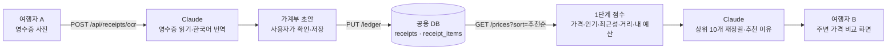

# 여행WON해의 AI 활용

- 작성일: 2026-10-28
- 기준 코드: `jpyo` 브랜치 `ed36696`
- 대상 독자: 팀원, 해커톤 발표·심사 준비

여행WON해는 **여행 가계부(PAGE 1)**와 **주변 가격 비교(PAGE 2)** 두 화면으로 된 앱입니다. 해커톤 주제(금융 + AX)에 맞춰, 사용자가 돈을 쓰는 순간과 돈을 쓰기 전에 AI가 돕도록 했습니다.

| 기능 | 화면 | AI가 하는 일 | 상태 | 상세 문서 |
| --- | --- | --- | --- | --- |
| 영수증 OCR | PAGE 1 영수증 추가 | 사진에서 매장·날짜·통화·카테고리·상품·가격을 읽고, 매장명과 상품명을 한국어로 옮김 | 적용 | [receipt-ocr.md](receipt-ocr.md) |
| 추천순 | PAGE 2 검색·카테고리 | 데이터 점수로 고른 상위 후보를 내 예산·소비 성향에 맞게 다시 고르고 추천 이유를 씀 | 적용 | [price-recommendation.md](price-recommendation.md) |
| 소비 인사이트 | PAGE 1 '나의 소비 인사이트' | 다른 여행자 데이터와 비교한 소비 분석 문장 | 보류 (지금은 규칙 기반) | 이 문서 5장 |

**서비스의 핵심은 PAGE 2 추천순**입니다. "같은 상품을 더 좋은 가격에 사도록 돕는다"는 목표가 금융 주제와 가장 직접 맞닿아 있기 때문입니다. 영수증 OCR은 그 추천에 필요한 데이터를 쉽게 모으는 입구 역할을 합니다.

## 1. 두 기능은 어떻게 이어지나요

1. 여행자 A가 영수증을 찍으면 Claude가 내용을 읽고, 일본어 매장명·상품명을 한국어로도 옮겨 줍니다.
2. A가 확인하고 저장하면 가계부가 서버에 저장되고, 그 영수증의 매장·상품·가격이 다른 여행자에게 공유됩니다.
3. 여행자 B가 "도리토스"를 검색하면, 서버가 반경 3km 안의 기록을 점수로 정렬합니다. Claude는 그 상위 후보를 B의 예산 상황에 맞게 다시 고르고 이유를 붙입니다.

OCR이 만든 한국어 이름(`storeKo`, `nameKo`)이 있어야 B가 한국어로 검색했을 때 `DORITOS ナチョチーズ 60G` 같은 원문 영수증도 찾을 수 있습니다. 두 AI 기능은 데이터로 이어져 있습니다.

## 2. 공통 기술

| 항목 | 내용 |
| --- | --- |
| 모델 | Anthropic Claude. 기본값 `claude-haiku-5-5`, 환경 변수 `AI_MODEL`로 바꿀 수 있음 |
| 연결 | Spring AI 2.0.1 (`spring-ai-starter-model-anthropic`)의 `ChatClient` |
| 응답 형식 | Spring AI `BeanOutputConverter`로 JSON 스키마를 프롬프트에 붙이고, 응답 JSON을 자바 record로 변환 |
| API 키 | `ANTHROPIC_API_KEY` 하나를 두 기능이 함께 씀. `.env` 또는 환경 변수에서만 읽고 코드·문서에는 쓰지 않음 |
| 공통 설정 (`application.properties`) | `max-tokens=16000`, `timeout=60s`, `max-retries=0` |
| 키가 없을 때 | 서버는 정상으로 뜸. OCR만 `OCR_UNAVAILABLE`로 거절하고, 추천순은 1단계 점수 순서만 씀 |

**왜 Spring AI인가요?** 팀 참고 저장소([WONIT-A/05_springAI](https://github.com/WONIT-A/05_springAI.git))와 같은 스택(Java 21, Spring Boot, Spring AI)을 쓰기로 했기 때문입니다. `ChatClient`를 쓰면 모델 이름·시간 제한 같은 설정을 코드 밖(`application.properties`)에 둘 수 있고, 테스트에서는 AI 부분만 가짜 구현으로 바꿀 수 있습니다.

**왜 Claude Haiku인가요?** 두 기능 모두 사용자가 화면 앞에서 기다리는 작업이라 응답 속도와 호출 비용이 중요합니다. 그래서 가볍고 빠른 모델을 기본으로 두었습니다. 일본어 영수증 읽기, 한국어 번역, 정해진 JSON 형식 지키기를 한 번의 호출로 처리할 수 있습니다. 더 높은 정확도가 필요하면 코드를 바꾸지 않고 `AI_MODEL`만 바꾸면 됩니다.

## 3. 설계 원칙

두 기능 모두 같은 원칙을 따릅니다.

1. **AI는 제안하고, 확인은 코드와 사람이 합니다.**
   - OCR 결과는 서버가 형식을 검사합니다. 그다음 앱이 "AI 인식 결과예요. 구매일·단가·합계를 꼭 확인해 주세요."라고 알리고, 사용자가 고친 뒤 저장합니다.
   - 추천 결과도 서버가 검사합니다. 후보에 없는 id나 중복 id는 버리고, 이유는 40자로 자릅니다.
2. **AI가 실패해도 기능은 멈추지 않습니다.**
   - OCR이 실패하면 직접 입력으로 이어집니다.
   - 추천 AI가 실패하거나 시간을 넘기면, AI 없이 계산한 1단계 점수 순서를 보여 줍니다.
3. **숫자는 지어내지 않습니다.**
   - OCR에는 "영수증에 찍힌 것만 읽고, 모르면 null"이라고 지시합니다.
   - 추천에는 "주어진 필드만 근거로 쓰고, 가격·평점·재고·영업시간을 만들지 말라"고 지시합니다.
   - 추천 점수와 비교 기준 숫자는 AI가 아니라 서버가 DB에서 계산합니다.
4. **입력 속 지시문은 따르지 않습니다.** 영수증 사진에 인쇄된 문구, 다른 여행자가 올린 매장명·상품명은 데이터로만 다루라고 프롬프트에 적었습니다. 프롬프트 인젝션을 막기 위해서입니다.
5. **필요한 만큼만 보냅니다.**
   - OCR은 사진 한 장만 Claude에 넘깁니다. 서버는 사진을 DB나 파일로 저장하지 않습니다.
   - 추천은 후보 10개의 매장·상품·가격 요약과 "남은 예산 %, 가장 많이 쓴 카테고리"만 보냅니다. 기기 토큰, 좌표, 다른 영수증은 보내지 않습니다.
6. **비용과 대기 시간에 상한을 둡니다.**
   - OCR은 IP당 시간당 20회로 제한합니다.
   - 추천은 결과를 캐시해 두고(같은 조건 10분, 실패는 1분), 8초가 지나면 포기하며, 동시에 2건까지만 호출합니다.

## 4. 테스트 방법

실제 Claude를 부르지 않고도 AI가 들어간 흐름 전체를 확인할 수 있게 했습니다.

| 테스트 | AI 대체 방법 | 확인하는 것 |
| --- | --- | --- |
| `ReceiptDraftMapperTest` (Java) | AI 응답 값을 직접 만들어 넣음 | 잘못된 날짜·통화·금액·상품 처리 |
| `TravelApiTest` (Java) | `ReceiptReader`, `PriceRanker`를 Mockito 가짜 구현으로 교체 | OCR API 응답·오류 코드, 추천 AI 결과 검사·캐시·실패 시 점수 순서 |
| `scripts/browser-check.mjs` (브라우저 E2E) | 가짜 Anthropic Messages API 서버를 띄우고 `spring.ai.anthropic.base-url`을 그쪽으로 돌림 | 실제 Spring AI 요청·구조화 응답 변환 경로, 화면의 'AI 추천' 배지와 순서 |

## 5. 한계와 다음 단계

- **실제 Claude 응답 품질은 자동 테스트로 검증하지 않았습니다.** 일본어 영수증 인식률, 한국어 번역의 일관성, 추천 이유의 자연스러움은 실제 키로 사진과 검색을 해 보며 확인해야 합니다.
- **같은 상품의 번역이 다르면 비교가 끊깁니다.** 서버는 상품명을 정규화해서 비교합니다(NFKC, 소문자, 공백 제거, 용량 단위 통일). 하지만 "나초치즈"와 "나쵸치즈"처럼 AI 번역이 다르게 나오면 다른 상품으로 봅니다.
- **추천에 쓸 행동 데이터가 영수증뿐입니다.** 클릭·조회 기록이 없어서, 일반 쇼핑앱의 학습형 추천과 달리 점수와 LLM 판단을 섞는 방식을 택했습니다. 시연 지역(신주쿠) 밖은 기록이 적어 추천순이 가격순과 비슷해질 수 있습니다.
- **소비 인사이트 AI화는 보류했습니다.** 지금 '나의 소비 인사이트'는 고정된 시연 평균과 비교하는 규칙 기반 문장(`spendingInsight`)입니다. 다음처럼 바꾸는 설계를 검토했습니다.
  1. 서버가 같은 도시·통화 여행자들의 실제 카테고리 비중과 하루 평균 지출을 DB에서 계산합니다.
  2. Claude는 그 숫자만으로 문장을 씁니다.
  3. 실패하면 지금 문장을 그대로 씁니다.

  추천순에서 만든 가계부 요약(`recommendProfile`)을 그대로 다시 쓸 수 있습니다.
