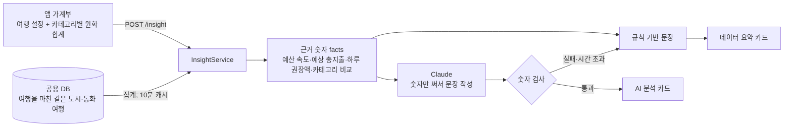

# AI 소비 인사이트

- 화면: PAGE 1 여행 가계부 → **나의 소비 인사이트** 카드
- API: `POST /insight` (JSON, `Authorization` 기기 토큰은 선택)
- 주요 코드

| 위치 | 하는 일 |
| --- | --- |
| [domain.mjs](../../src/domain.mjs) `insightRequest` | 가계부에서 요청 본문(여행 설정 + 카테고리별 원화 합계)을 만듦 |
| [Ledger.tsx](../../src/screens/Ledger.tsx) | 가계부가 바뀌면 0.6초 뒤 요청, 카드 표시, 서버 연결 실패 시 기기 안의 규칙 문장 |
| [InsightController.java](../../src/main/java/com/wonit/travel/api/InsightController.java) | API 입구 |
| [InsightService.java](../../src/main/java/com/wonit/travel/insight/InsightService.java) | 비교 기준 집계, 근거 숫자 계산, 규칙 기반 문장, AI 문장 검사·캐시 |
| [ReceiptRepository.java](../../src/main/java/com/wonit/travel/ledger/ReceiptRepository.java) `spendingOfFinishedTrips` | 여행을 마친 같은 도시·통화 여행자의 기기·카테고리별 지출 합계 조회 |
| [ClaudeSpendingAdvisor.java](../../src/main/java/com/wonit/travel/insight/ClaudeSpendingAdvisor.java) | Claude 호출(프롬프트) |
| [SpendingAdvisor.java](../../src/main/java/com/wonit/travel/insight/SpendingAdvisor.java), [InsightConfig.java](../../src/main/java/com/wonit/travel/insight/InsightConfig.java) | AI 인터페이스와 연결 설정 |

## 1. 왜 바꿨나요

이전의 '나의 소비 인사이트'는 기기 안에서 만든 한 문장이었습니다. 가장 많이 쓴 카테고리의 비중을 코드에 고정해 둔 **시연 평균**(예: 숙박 42%)과 비교했습니다.

> 이번 여행은 숙박에 가장 많이 사용했어요. 숙박 비중은 78%로, 시연 평균보다 36%p 높아요.

여기에는 세 가지 아쉬움이 있었습니다.

1. **비교 기준이 가짜였습니다.** 화면에도 "실제 여행자 통계가 아니에요"라고 적혀 있었습니다.
2. **돈 관리에 필요한 정보가 없었습니다.** 예산을 얼마나 빨리 쓰고 있는지, 이대로 가면 예산을 넘는지, 남은 기간에 하루 얼마를 쓸 수 있는지 알려 주지 않았습니다.
3. **매번 같은 틀의 문장이었습니다.**

그래서 **숫자는 실제 데이터로 서버가 계산하고, AI는 그 숫자로 상황에 맞는 문장과 제안을 쓰도록** 바꿨습니다.

## 2. 구조



추천순과 같은 원칙으로 두 층을 나눴습니다.
- **1층(서버 계산):** 결과가 항상 같습니다. 이것만으로도 카드가 완성됩니다.
- **2층(AI):** 같은 숫자를 더 자연스럽고 상황에 맞는 말로 바꿉니다.

## 3. 무엇을 보내나요 (앱 → 서버)

```json
{
  "trip": { "city": "도쿄", "country": "일본", "start": "2026-10-24", "end": "2026-10-30",
            "budget": 1000000, "currency": "JPY", "rate": 9.24 },
  "categories": { "음식": 20661, "쇼핑": 82975, "숙박": 548856, "교통": 27720, "관광": 22176, "기타": 0 }
}
```

- 위 값은 앱의 시연 가계부(`createDemo`)로 만든 실제 요청 본문입니다.
- `categories`는 앱이 가계부 차트에 쓰는 `summarize` 결과(영수증마다 적용 환율로 바꾼 원화 합계)를 그대로 씁니다.
- **영수증 원문, 매장, 상품, 위치는 보내지 않습니다.**
- 기기 토큰이 있으면 서버가 비교 기준에서 **요청한 기기 자신을 뺍니다.**
- 서버는 여행 설정을 가계부 저장과 같은 규칙(`LedgerService.validateTrip`)으로 검사합니다. 카테고리는 6개 중에서만, 금액은 0원~1조 원만 받고, 어기면 400입니다.

## 4. 서버가 계산하는 숫자

### 4.1 내 가계부

| 값 | 계산 | 시연 가계부 예 (2026-10-28 기준) |
| --- | --- | --- |
| 여행 기간 `days` | 종료일 − 시작일 + 1 | 7일 |
| 지난 날 `elapsedDays` | 오늘(서울 기준)까지, 오늘 포함. 시작 전이면 0 | 5일 |
| 여행 경과율 `progressPct` | 지난 날 ÷ 기간 | 71% |
| 예산 사용률 `usedPct` | 총지출 ÷ 예산 | 70% |
| 하루 평균 `dailyAverage.mine` | 총지출 ÷ 지난 날 | 140,478원 |
| 예상 총지출 `projectedTotal` | 하루 평균 × 기간 (지금 속도로 끝까지 쓸 때) | 983,343원 (예산의 98%) |
| 하루 권장액 `safeDailyBudget` | 남은 예산 ÷ 남은 날 | 148,806원 |
| 예산 초과액 `overBudget` | 총지출 − 예산 (넘었을 때만) | - |
| 카테고리 비중 `minePct` | 카테고리 합계 ÷ 총지출 | 숙박 78% |

### 4.2 비교 기준: 여행을 마친 같은 도시·통화 여행자

- **대상:** `trips.city`와 `trips.currency`가 같고, **종료일이 오늘보다 앞선** 여행입니다. 진행 중인 여행은 지출이 아직 다 모이지 않아 평균을 낮추기 때문에 뺍니다.
- **금액:** 영수증마다 `최소 단위 금액 × 적용 환율 ÷ 10^소수자릿수`로 원화로 바꿔 기기·카테고리별로 합칩니다.

| 값 | 계산 |
| --- | --- |
| `peers.count` | 지출이 있는 비교 대상 여행 수 (요청한 기기 제외) |
| 카테고리 평균 비중 `peersPct` | 여행자마다 카테고리 비중을 구한 뒤 평균 (지출이 큰 한 사람이 평균을 끌고 가지 않도록) |
| 차이 `diffPp` | 내 비중 − 평균 비중 (%p) |
| 하루 지출 중앙값 `dailyAverage.peersMedian` | 여행자마다 총지출 ÷ 여행 기간, 그 중앙값 |
| 예산 사용률 중앙값 `medianBudgetUsedPct` | 여행자마다 총지출 ÷ 예산, 그 중앙값 |

- **5명 미만이면 비교하지 않습니다.** 몇 명 안 되는 기록으로 평균을 보여 주면 특정 여행자의 지출을 짐작할 수 있기 때문입니다. 이때는 내 가계부 숫자만으로 분석합니다.
- **중앙값을 쓰는 이유:** 하루 지출과 예산 사용률은 일부 큰 지출에 흔들리기 쉬워서 평균 대신 중앙값을 씁니다.
- **집계 캐시:** 도시·통화·날짜별로 10분 동안 캐시합니다. 그사이 누군가 영수증을 새로 저장하면(가장 최근 영수증 번호가 바뀌면) 다시 집계합니다.
- **표시:** 비교 기준에 시연 가데이터 기기(`devices.is_sample`)가 섞이면 카드에 "(시연 가데이터 포함)"이라고 표시합니다.

> **공유 동의와의 관계:** 비교 기준에는 PAGE 2 가격 공유에 쓰지 않는 영수증(예: 위치가 없는 교통 영수증)도 합계로만 들어갑니다. 공유 영수증만 쓰면 교통비 비중이 0%처럼 보여 비교가 틀어지기 때문입니다. 개인별 값은 내보내지 않고, 5명 이상의 평균·중앙값만 씁니다. 팀 정책이 바뀌면 `spendingOfFinishedTrips` 조회에 `r.shareConsent = true` 조건을 더하면 됩니다.

## 5. Claude에게 무엇을 시키나요

### 5.1 보내는 데이터 (facts)

4장의 숫자만 JSON으로 보냅니다. 금액은 화면에 쓸 형태 그대로(`"983,343원"`) 보냅니다.

```json
{
  "trip": { "city": "도쿄", "days": 7, "elapsedDays": 5, "remainingDays": 2, "progressPct": 71 },
  "budget": { "budget": "1,000,000원", "spent": "702,388원", "usedPct": 70, "projectedTotal": "983,343원",
              "projectedPct": 98, "safeDailyBudget": "148,806원", "overBudget": null },
  "dailyAverage": { "mine": "140,478원", "peersMedian": "265,059원" },
  "categories": [ { "name": "숙박", "minePct": 78, "peersPct": 42, "diffPp": 36 }, "…" ],
  "peers": { "count": 297, "description": "여행을 마친 도쿄 여행자 297명", "medianBudgetUsedPct": "…" }
}
```

(시연 가계부와 공용 DB로 실제로 계산한 값입니다. `…`은 이 문서에서 생략한 값입니다.)

### 5.2 지시 내용 (요약)

- 친근한 해요체로 쓴다.
  - **headline:** 가장 중요한 발견 하나, 30자 이내
  - **body:** 예산 속도와, 다른 여행자와 가장 다른 카테고리(비교 기준이 없으면 가장 큰 카테고리)에 대한 두 문장, 120자 이내
  - **tip:** 남은 여행을 위한 구체적인 제안 하나, 60자 이내 (쓸 말이 없으면 null)
- **facts에 있는 숫자만, 적힌 그대로** 쓴다. 새로 계산하거나 반올림하거나 바꾸지 않고, 날짜도 쓰지 않는다.
- 가격, 장소, 환율, 다른 여행자에 대해 facts에 없는 내용을 만들지 않는다.
- 비교 기준(`peers`)이 null이면 다른 여행자와 비교하지 않는다.
- 사용자를 탓하지 않고, 예산 안에서 여행을 즐기도록 돕는다.

### 5.3 AI 문장 검사 (`InsightService.checked`)

AI 문장은 그대로 보여 주지 않고 아래 검사를 통과할 때만 씁니다.

| 검사 | 처리 |
| --- | --- |
| 제목이나 본문이 비었음 | 버리고 규칙 문장 |
| **문장 속 숫자가 facts에 없음** (쉼표를 뺀 숫자끼리 비교) | 버리고 규칙 문장, 서버 로그에 `근거 없는 숫자` 경고 |
| 줄바꿈·제어 문자 | 공백으로 바꿈 |
| 너무 긴 문장 | 제목 40자, 본문 160자, 제안 80자에서 자름 |

숫자 검사가 이 기능에서 가장 중요한 장치입니다. AI가 "예산의 85%를 썼어요"처럼 계산하지 않은 숫자를 쓰면, 문장이 아무리 자연스러워도 내보내지 않습니다. 금융 정보에서 그럴듯하지만 틀린 숫자는 아예 없는 것보다 해롭기 때문입니다.

### 5.4 비용·속도 보호

| 장치 | 값 |
| --- | --- |
| 캐시 | 같은 facts면 10분 재사용 (같은 화면을 다시 열어도 호출하지 않음), 최대 200건 |
| 실패 캐시 | 1분 |
| 시간 제한 | 8초 (넘으면 규칙 문장) |
| 동시 호출 | 2건 + 대기 4건, 넘치면 바로 규칙 문장 |
| 앱 요청 지연 | 가계부가 바뀌고 0.6초 뒤 요청 (연속 수정 시 마지막 한 번만) |
| 지출 0원 | AI를 부르지 않고 "첫 영수증을 기록해 보세요" 안내 |
| 키 없음 | AI를 부르지 않음 |

## 6. 규칙 기반 문장 (AI가 없거나 실패할 때)

같은 숫자로 서버가 직접 씁니다. 위에서부터 처음 맞는 제목을 고릅니다.

| 조건 | 제목 |
| --- | --- |
| 여행 시작 전 | 여행 전 지출을 기록하고 있어요 |
| 예상 총지출이 예산의 100% 초과 | 이대로면 예산의 N%를 쓰게 돼요 |
| 예산 사용률이 여행 경과율보다 10%p 넘게 높음 | 예산을 여행 속도보다 빨리 쓰고 있어요 |
| 그 밖에 예산이 있음 | 예산 안에서 잘 쓰고 있어요 |
| 예산 0원 | (가장 큰 카테고리)에 가장 많이 썼어요 |

- **본문:**
  - 첫째 문장: "예산의 N%를 썼고, 여행은 N% 지났어요."
  - 둘째 문장: 비교 기준과 3%p 이상 차이 나는 카테고리 중 차이가 가장 큰 것을 씁니다. 예: "숙박 비중은 78%로, 여행을 마친 도쿄 여행자 297명 평균보다 36%p 높아요." 비교 기준이 없으면 "숙박 비중이 78%로 가장 커요."라고 씁니다.
- **제안:**
  - 남은 날이 있고 예산이 남았으면 "남은 2일은 하루 148,806원 안에서 쓰면 예산을 지킬 수 있어요."라고 씁니다.
  - 예산을 넘었으면 "예산을 N원 넘었어요. 남은 일정은 꼭 필요한 지출 위주로 계획해 보세요."라고 씁니다.

## 7. 화면

| 배지 | 뜻 |
| --- | --- |
| `분석 중` | 서버에 요청 중 (이전 내용이 그대로 보임) |
| `AI 분석` (파란 배지) | 숫자 검사를 통과한 AI 문장 |
| `데이터 요약` | 서버가 계산한 규칙 기반 문장 (키 없음·AI 실패·검사 탈락) |
| `비율 기반 요약` | 서버에 연결하지 못해 기기 안의 예전 문장(`spendingInsight`, 시연 평균 비교) |

카드 구성:
1. **제목**과 **본문**
2. **제안** (흰 상자)
3. **근거 숫자 칩:** 서버 계산 값입니다. 예: `예산 70% 사용 · 여행 71% 경과`, `하루 평균 140,478원 · 여행자 중앙값 265,059원`, `이 속도면 총 983,343원`
4. **비교 기준 안내:** 예: "비교 기준: 여행을 마친 도쿄 여행자 297명의 영수증 (시연 가데이터 포함). 문장은 AI가 위 숫자만으로 썼어요."

근거 숫자를 문장과 따로 보여 주는 이유는, 사용자가 AI 문장을 숫자로 직접 확인할 수 있게 하기 위해서입니다.

## 8. 추천순에서 재사용한 것

| 재사용 | 내용 |
| --- | --- |
| `ai/StructuredClaude` (추천순에서 꺼냄) | 지시문 + 입력 JSON + 응답 스키마로 Claude 호출, 8초 제한, 동시 2건, 마지막 글 블록을 JSON으로 변환. 추천순(`ClaudePriceRanker`)과 인사이트(`ClaudeSpendingAdvisor`)가 함께 쓰고, OCR(`ClaudeReceiptReader`)은 응답 변환(`lastText`)만 같이 씀 |
| `ai/TtlCache` (추천순에서 꺼냄) | 만료 시간이 있는 메모리 캐시. 추천순 AI 결과, 인사이트 AI 결과, 비교 기준 집계에 씀 |
| 인터페이스 + 가짜 구현 패턴 | `PriceRanker`처럼 `SpendingAdvisor`를 두어 테스트에서 Mockito로 바꿈 |
| `LedgerService.validateTrip`, `LedgerService.hash` | 여행 설정 검사와 기기 토큰 해시를 가계부 저장과 같은 규칙으로 |
| 앱 `summarize` | 가계부 차트와 같은 원화 합계를 인사이트 요청에 그대로 씀 |
| 실패 시 AI 없는 결과 | 추천순의 "1단계 점수 순서"처럼 인사이트는 "규칙 기반 문장" |

## 9. 테스트

- **`TravelApiTest` (Java)**
  - `소비_인사이트는_여행을_마친_같은_도시_여행자와_비교한_숫자로_규칙_문장을_만든다`
    - 여행을 마친 도쿄 여행자 5명을 저장하고, 제목·본문·제안·근거 칩·비교 기준을 정확한 문자열로 확인합니다.
    - 그 5명 중 한 명의 토큰으로 요청하면 자기 자신이 빠져 4명이 되고, 그래서 비교하지 않는지 확인합니다.
    - 지출 0원 안내를 확인합니다.
  - `소비_인사이트_AI_문장은_계산한_숫자만_쓸_때_보여주고_아니면_규칙_문장을_쓴다`
    - 숫자를 지킨 AI 문장은 표시하고(줄바꿈 정리), 같은 숫자는 캐시를 써서 AI를 한 번만 부르는지 확인합니다.
    - 근거 없는 숫자(85%)가 나오면 버리는지, AI가 실패하면 규칙 문장을 쓰는지 확인합니다.
  - `소비_인사이트는_잘못된_요약을_거부한다`: 없는 카테고리, 음수 금액, 여행 설정 누락, 카테고리 누락
- **`tests/domain.test.mjs`:** `insightRequest`가 여행 설정과 카테고리 합계만 담고, 매장명 같은 영수증 내용은 담지 않는지 확인합니다.
- **`scripts/browser-check.mjs`**
  - 가짜 Anthropic 서버가 facts(서버 계산 숫자)를 받았는지, 매장명이 섞이지 않았는지 확인합니다.
  - 화면의 `AI 분석` 배지, AI 문장, 근거 칩(`예산 70% 사용`)을 확인합니다.
- **공용 MySQL 읽기 확인 (2026-10-28):** AI 키 없이 `mysql` 프로필로 서버를 띄워 시연 가계부로 요청했습니다.
  - 비교 기준: 여행을 마친 도쿄 여행자 297명
  - 응답 시간: 첫 응답 0.54초, 캐시 후 0.04초

## 10. 한계와 개선 방향

- **실제 Claude 문장 품질은 아직 확인하지 않았습니다.** 숫자 검사에서 자주 탈락하는지(예: AI가 "2일"을 "이틀"이 아닌 다른 숫자로 쓰는 경우)도 실제 키로 확인해야 합니다.
- **숫자 검사는 숫자만 봅니다.** "예산을 넘었어요"처럼 숫자 없는 틀린 판단은 잡지 못합니다. 지시문과 규칙 문장으로 줄이고 있습니다.
- **카테고리 차트의 '다른 여행자의 소비와 비교하기'는 아직 고정된 시연 평균을 씁니다.** 이번 인사이트의 비교 기준 숫자(`peersPct`)를 차트에도 쓰면 화면 전체가 같은 기준이 됩니다.
- **비교 기준은 도시 이름이 정확히 같아야 합니다.** "도쿄"와 "Tokyo"는 다른 도시로 봅니다.
- **캐시는 서버 메모리에만 있습니다.** 서버를 다시 켜면 비워지고, 서버가 여러 대면 따로 갖습니다.
